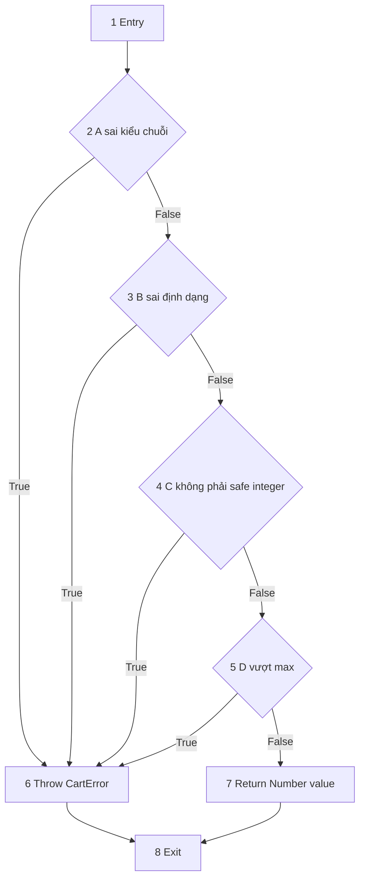
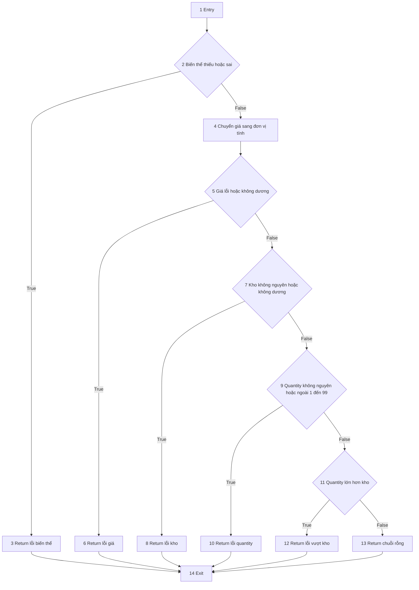

# Thiết kế kiểm thử hộp trắng TechZone

Tài liệu phục vụ phần thiết kế kiểm thử trong báo cáo. Đối tượng là mã JavaScript thật của TechZone; không xây một chương trình Java thay cho backend. Các test WB dưới đây là thiết kế mới, chưa chạy và chưa có kết quả coverage. Không suy ra 100% coverage từ sơ đồ hoặc số ca.

## 1 Phạm vi và quy ước

Chọn hai hàm nhỏ có quy tắc nghiệp vụ rõ ràng:

| Hàm | Vị trí | Lý do chọn |
| --- | --- | --- |
| positiveInteger | src/utils/cart-validation.js | Kiểm tra ID/số lượng; có điều kiện ghép OR và short circuit |
| variantProblem | src/services/cart-service.js | Chuỗi kiểm tra biến thể, giá, kho và số lượng; nhiều nhánh trả về sớm |

Ngoài ra dùng quote trong src/utils/checkout.js để thiết kế kiểm tra lặp qua nhiều dòng giỏ và ngưỡng phí. quote dùng Array.map, không có vòng for/while viết trực tiếp trong thân hàm.

Quy ước CFG: một điểm vào, một điểm ra chung; return/throw nối về điểm ra. Chỉ mô hình hóa nhánh tường minh, không vẽ mọi ngoại lệ có thể phát sinh trong regex, Number, BigInt hoặc thư viện. Dữ liệu nghiệp vụ theo hợp đồng đầu vào; các tình huống dữ liệu hỏng được chỉ rõ riêng.

Độ phức tạp chu trình V(G)=E−N+2 với CFG liên thông một thành phần. Nếu coi mỗi if ghép là một quyết định thì cách đếm khác với CFG tách từng toán hạng short circuit. Phải ghi quy ước, không so hai con số khác quy ước rồi kết luận một công cụ sai.

## 2 Hàm positiveInteger

### 2.1 Mã nguồn được phân tích

```javascript
function positiveInteger(value, max = 2147483647) {
  if (typeof value !== 'string' || !/^[1-9]\d*$/.test(value) ||
      !Number.isSafeInteger(Number(value)) || Number(value) > max) {
    throw new CartError('Mã sản phẩm hoặc số lượng không hợp lệ. Số lượng phải là số nguyên từ 1 đến 99.');
  }
  return Number(value);
}
```

Thông báo nhắc1–99 nhưng max mặc định là2147483647; khi dùng cho quantity, caller truyền99. Không lấy câu thông báo để suy ra mọi lần gọi đều giới hạn99. Giá trị dạng chuỗi `01`, `+1`, `1.0` không khớp regex dù có thể chuyển thành số nguyên.

### 2.2 CFG tách điều kiện short circuit

Đặt A=`typeof value !== 'string'`; B=`!regex.test(value)`; C=`!Number.isSafeInteger(Number(value))`; D=`Number(value)>max`. OR dừng ngay khi một toán hạng đúng; các toán hạng sau có thể chưa được đánh giá.



N=8, E=11 nên V=11−8+2=5. Có4 nút quyết định nhị phân nên cũng tính được4+1=5. Nếu gộp toàn bộ if thành một nút, CFG mức quyết định tổng hợp có V=2; đó không phải CFG8nút ở trên.

### 2.3 Đường cơ sở và dữ liệu

Các ca dùng max=99 để đại diện validation quantity; trừ ca nêu riêng. Mỗi đường sau thêm ít nhất một cạnh chưa xuất hiện trong các đường trước.

| ID | Đường đi | value | Kết quả mong đợi |
| --- | --- | --- | --- |
| WB-INT-01 | 1→2T→6→8 | number1, không phải chuỗi | Throw CartError, status422 |
| WB-INT-02 | 1→2F→3T→6→8 | chuỗi `0` | Throw422 vì regex |
| WB-INT-03 | 1→2F→3F→4T→6→8 | chuỗi `9007199254740992` | Throw422 vì không safe integer |
| WB-INT-04 | 1→2F→3F→4F→5T→6→8 | chuỗi `100` | Throw422 vì vượt99 |
| WB-INT-05 | 1→2F→3F→4F→5F→7→8 | chuỗi `1` | Trả số1 |

Bổ sung WB-INT-06: chuỗi `99`, max99 trả99; WB-INT-07: chuỗi `2147483647`, không truyềnmax, trả2147483647; WB-INT-08: chuỗi `2147483648`, không truyềnmax, Throw422. Các ca bổ sung phân biệt biên nghiệp vụ với đường điều khiển, không làm V tăng.

### 2.4 Thiết kế bao phủ

| Tiêu chí | Bộ ca dự kiến | Giới hạn kết luận |
| --- | --- | --- |
| Statement | WB-INT-01 và05 | Đi qua throw và return; chưa nói mọi toán hạng đã được đánh giá |
| Decision tổng hợp | WB-INT-01 và05 | Toàn bộ biểu thức if có cảTrue vàFalse |
| Branch theo CFG short circuit | WB-INT-01 đến05 | Từng nút A/B/C/D có cả cạnhTrue/False |
| Condition coverage | WB-INT-01 đến05 | Mỗi toán hạng được đánh giá thật ít nhất một lầnTrue vàFalse |

### 2.5 CDC và MC/DC

Condition/decision coverage (CDC) đòi mỗi điều kiện và quyết định có cả kết quảTrue/False, nhưng không tự chứng minh từng điều kiện ảnh hưởng độc lập lên quyết định. MC/DC còn cần các cặp thể hiện ảnh hưởng độc lập.

Ở biểu thức này, các điều kiện đều phụ thuộc value và có short circuit. Không được gọi bộ5ca trên là đã đạt strict unique-cause MC/DC: đổi value để làm A=True cũng thay cách xác định các điều kiện khác, và B/C/D có thể không được đánh giá. Nếu khảo sát masking MC/DC phải công bố quy tắc và dữ liệu/cặp tương ứng; đợt thiết kế này chưa cam kết MC/DC.

Khi trình bày có thể chứng minh ảnh hưởng D bằng WB-INT-04/05: A/B/C đềuFalse, D đổiTrue/False nên quyết định đổi. Nhưng một cặp này chưa đủ chứng minh MC/DC cho toàn biểu thức.

## 3 Hàm variantProblem

### 3.1 Mã nguồn được phân tích

```javascript
function variantProblem(variant, quantity) {
  if (!variant || !Number(variant.valid_variant)) return 'Sản phẩm hoặc biến thể không còn hợp lệ.';
  const price = priceUnits(variant.price);
  if (price === null || price <= 0n) return 'Biến thể chưa có giá bán hợp lệ.';
  if (!Number.isInteger(Number(variant.stock)) || Number(variant.stock) <= 0) return 'Biến thể đã hết hàng.';
  if (!Number.isInteger(Number(quantity)) || quantity < 1 || quantity > 99) return 'Số lượng phải từ 1 đến 99.';
  if (quantity > Number(variant.stock)) return `Số lượng vượt tồn kho hiện tại (${variant.stock}). Vui lòng giảm số lượng.`;
  return '';
}
```

Đây là thứ tự ưu tiên thông báo. Một fixture vừa sai giá vừa hết kho sẽ dừng ở giá; không dùng nó để khẳng định nhánh kiểm tra kho đã chạy.

### 3.2 CFG mức if tổng hợp



N=14, E=18 nên V=18−14+2=6, cũng bằng5if+1. Đây là đồ thị gộp điều kiện. Nếu tách từng toán hạng short circuit: if1 có2, if2 có2, if3 có2, if4 có3, if5 có1 quyết định, tổng10 nên V=11. Không dùng6ca đường cơ sở của đồ thị gộp để tuyên bố đã bao phủ mọi nhánh short circuit.

### 3.3 Đường cơ sở và dữ liệu đại diện

Fixture chuẩn V0: `{valid_variant:1, price:'100000.00', stock:5}`. Mỗi ca tạo bản mới từ V0, không dùng lại object đã bị ca trước sửa.

| ID | Đường gộp | Dữ liệu thay đổi so với V0 | Mong đợi |
| --- | --- | --- | --- |
| WB-VAR-01 | 1→2T→3→14 | variant=null, quantity1 | Lỗi biến thể |
| WB-VAR-02 | 1→2F→4→5T→6→14 | price='0.00', quantity1 | Lỗi giá |
| WB-VAR-03 | 1→2F→4→5F→7T→8→14 | stock0, quantity1 | Lỗi kho |
| WB-VAR-04 | 1→2F→4→5F→7F→9T→10→14 | quantity0 | Lỗi quantity |
| WB-VAR-05 | 1→2F→4→5F→7F→9F→11T→12→14 | quantity6 | Lỗi vượt kho5 |
| WB-VAR-06 | 1→2F→4→5F→7F→9F→11F→13→14 | quantity1 | Chuỗi rỗng, không có vấn đề |

Bộ6ca dự kiến bao phủ mọi return và cả hai cạnh của5if trên CFG gộp. Chưa đo coverage thực tế và chưa bao phủ đầy đủ toán hạng.

### 3.4 Dữ liệu bổ sung cho điều kiện ghép

| ID | Dữ liệu | Mục tiêu |
| --- | --- | --- |
| WB-VAR-07 | V0 nhưng valid_variant=0, quantity1 | Toán hạng thứ2 của if1True khi variant tồn tại |
| WB-VAR-08 | V0 nhưng price='abc', quantity1 | priceUnits trảnull; tách khỏi ca giá0 |
| WB-VAR-09 | V0 nhưng stock=1.5, quantity1 | Toán hạng kiểm tra kho không nguyênTrue |
| WB-VAR-10 | V0, quantity1.5 | Toán hạng quantity không nguyênTrue |
| WB-VAR-11 | V0, quantity100 | Toán hạng quantity>99True; không bị toán hạng trước che |
| WB-VAR-12 | V0, quantity5 | Quantity đúng bằng kho, nhánh vượt khoFalse |
| WB-VAR-13 | V0 nhưng stock100, quantity99 | Biên trên quantity hợp lệ, không bị kho5 che |

Các ca01–11 đủ dữ liệu dự kiến để các toán hạng tường minh cóTrue/False, kết hợp ca06. Kết luận đạt CDC/branch vẫn phải đối chiếu công cụ và trace. Không gọi đây là chứng minh MC/DC hoặc bao phủ mọi exception của thư viện.

## 4 Kiểm tra lặp và giới hạn tính tiền trong quote

quote gọi items.map để xử lý từng dòng. Thư viện thực hiện việc lặp; báo cáo mô tả số lần callback được gọi, không dựng vòngfor rồi tuyên bố đó là mã nguồn hiện có.

Fixture dòng chuẩn: có product_id/variant_id, valid_variant=1, stock10, quantity1, price='100000.00', tên/SKU nhân tạo. Giữ các dòng có variant_id riêng khi kiểm tra nhiều dòng.

| ID | Đầu vào | Hành vi hoặc nhánh cần kiểm tra | Kỳ vọng |
| --- | --- | --- | --- |
| WB-QUOTE-01 | [] | Dừng trướcmap, callback0lần | Throw409 do giỏ trống |
| WB-QUOTE-02 | 1dòng giá100000.00, qty1 | Callback1lần; dưới ngưỡng | subtotal100000.00, phí30000.00, total130000.00 |
| WB-QUOTE-03 | 2dòng giá100000.00 và200000.00, qty1 | Callback2lần; cộng đủ; đúng ngưỡng | subtotal300000.00, phí0.00, total300000.00 |
| WB-QUOTE-04 | Dòng1hợp lệ, dòng2qty11/kho10 | Callback dừng bằng throw khi xử lý dòng2 | Throw409; không trả báo giá hoàn chỉnh; hàm không ghi database |
| WB-QUOTE-05 | Dòng giá100000.01, qty3 | Nhân và cộng đơn vị tiền nguyên | subtotal300000.03, phí0.00 |
| WB-QUOTE-06 | Một dòng giá9999999999.99, qty1, kho10 | Tổng đúng giới hạn999999999999đơn vị nhỏ | Được nhận; total9999999999.99 |
| WB-QUOTE-07 | Hai dòng: giá9999999999.99 và0.01, mỗi dòngqty1 | Tổng vượt giới hạn1đơn vị nhỏ | Throw409 do tổng vượt giới hạn |

Một đơn vị tính nội bộ là0.01đ: ngưỡng300.000đ tương ứng30000000n, giới hạn tổng999999999999n tương ứng9.999.999.999,99đ. Không nhầm BigInt nội bộ thành số đồng hiển thị.

Các giá trị cực đại ở đây dùng kiểm thử hàm độc lập; không suy ra UI cho phép người dùng nhập giá hoặc catalog có sản phẩm thực giá đó. Không viết CFG tổng hợp xuyên callback/thư viện rồi so trực tiếp với V của riêng hàm quote do công cụ tính.

## 5 Truy vết với yêu cầu và kiểm thử đã có

| Bộ WB | Yêu cầu | Liên kết bộ TC gốc |
| --- | --- | --- |
| WB-INT | REQ-CART-02; kiểm tra ID theo route | TC-CART-03/04; ID sai trong các ca quyền/checkout |
| WB-VAR | REQ-CART-02, REQ-CART-04, REQ-PRICE-01 | TC-CART-03/04/09, TC-COD-03 |
| WB-QUOTE | REQ-PRICE-01/02/03, REQ-SHIP-01 | TC-PRICE-01 đến04, TC-COD-03 |

Các test C1 đã chạy có kiểm tra quote cho giỏtrống, vượt kho, phần lẻ và tiền hàng dưới/đúng/trên ngưỡng. Tuy nhiên fixture khác WB; chưa được tự gán toàn bộ WB làPass. Các ca WB mới không tự làm tăng59ca nghiệp vụ trước khi thống nhất cách đếm.

## 6 Cách đo và ghi nhận ở bước thực thi

1. Viết test độc lập trong bộ kiểm thử, import hàm thật. Không sửa hàm nghiệp vụ để làm đẹp kết quả; xác minh test không kết nối MySQL nếu chỉ kiểm thử hàm thuần.
2. Gắn IDWB vào tên test; dùng assert cho giá trị trả về hoặc status/thông báo lỗi, không chỉ kiểm tra “không crash”.
3. Chạy từng ca và lưu lệnh, bản mã, môi trường, log. Ca chưa cài đặt vẫnNot Run.
4. Đo coverage bằng công cụ hỗ trợ JavaScript; chốt phiên bản và phạm vi trước. Mỗi công cụ có cách đếm statement/branch khác nhau; báo cáo phải giữ đúng nhãn và mẫu số của công cụ.
5. Báo cáo riêng file/hàm và phần chưa chạy; không lấy coverage toànfile có nhiều hàm khác thay cho coverage của hàm được chọn. Không coi branch coverage tương đương MC/DC.
6. Nếu cần mutation, chạy trên bản sao biệt lập và ghi mutant bị phát hiện/sống sót/lỗi chạy; không chỉnh bản website đang dùng. Chưa thực hiện mutation trong bước này.

## 7 Cách trình bày khi thuyết trình

“Em chọn hàm kiểm tra số nguyên và hàm kiểm tra biến thể vì chúng quyết định dữ liệu có được mua hay không. Em vẽ luồng theo nhánh kiểm tra và return sớm. Với positiveInteger, em tách short circuit thành4quyết định nên V=5. Với variantProblem, đồ thị gộp5if cóV=6; nếu tách toán hạng thì cách đếm đổi. Em thiết kế dữ liệu để mỗi nhánh có tình huống đi qua, nhưng chỉ kết luận coverage đạt sau khi chạy và đo.”

## 8 Trạng thái đầu ra

Đã có2CFG bằng Mermaid, quy ước và phép tính V, bảng đường cơ sở, thiết kế statement/decision/condition/branch, giải thích giới hạn MC/DC và bảng kiểm tra callback lặp trong quote. Tổng28IDWB duy nhất:8INT,13VAR,7QUOTE. Tất cả28ca mới: **Not Run**. Chưa có ảnh sơ đồPNG/SVG để chèn Word; cần xuất hình khi biên soạn báo cáo. Chưa có kết quả coverage hoặc mutation trong tài liệu này.
